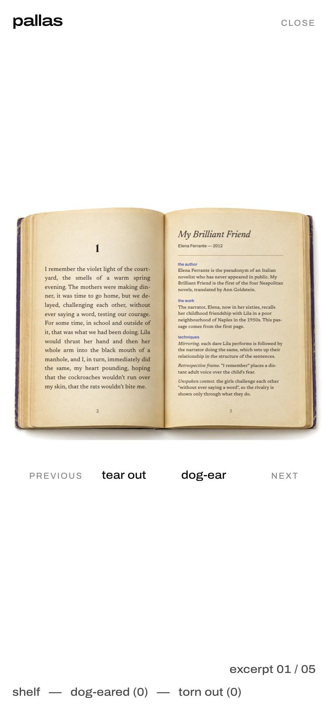
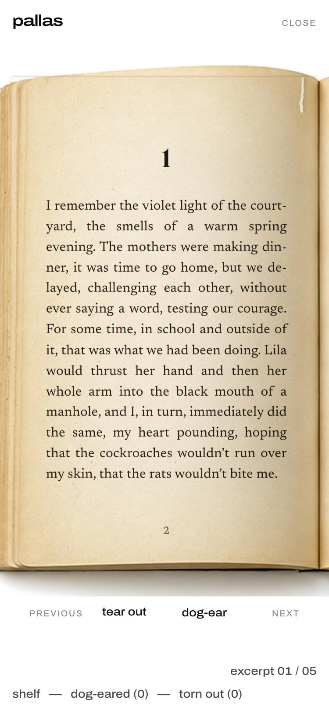
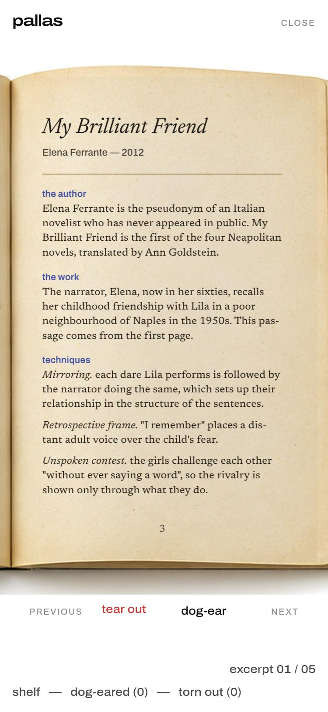

# Proposal: reading the paperback on a phone

**Status:** awaiting the owner's decision. Nothing in this proposal is implemented; the screenshots were made by adjusting the view in the browser, not by changing code.

## The problem

On a phone held upright, the open spread has to fit the screen width, so the book is drawn at about 47% of its designed size (at 375 px wide). The passage text then renders at **6.8 px** and the info page at **5.8 px**, which is too small to read comfortably. Turning the phone to landscape does not solve it: with the corner bars and the controls, the spread can only grow to about 7 px text (the height, not the width, is the limit).

| Width | Book scale today | Passage text today | Proposed text |
|---|---|---|---|
| 320 px | 0.42 (minimum) | 6.1 px | 13.0 px |
| 375 px | 0.47 | 6.8 px | 15.4 px |
| 390 px | 0.49 | 7.1 px | 16.1 px |
| 430 px | 0.55 | 7.9 px | 17.9 px |
| 768 px (tablet) | 1.03 | 15.0 px | unchanged: the full spread stays |

Proposed sizes stay below the 1.3 maximum scale that large desktop screens already use.

## Proposed solution: the same book, held closer

On phones in portrait (narrower than about 600 px), the open book is framed so that **one page fills the width of the screen**. It is the same photographic spread, with the same paper, gutter shadow, page edges, dog-ear and torn edge, and the same 3D page-turn. Only the camera moves closer, as if the reader had lifted the book.

| Passage page | Info page |
|---|---|
|  |  |

How it would behave:

1. **Opening.** The closed cover is shown as today. When it opens, the view eases in to the passage page during the existing opening animation.
2. **Moving between the two pages.** A horizontal swipe on the book, or a tap on the strip of the other page visible at the screen edge, slides the view to the info page and back. The book itself does not change; only the framing moves, using the existing easing curve.
3. **Dog-ear.** It is available while the info page is in view, using the current touch behaviour: the first tap lifts the corner, and a second tap folds it. The "dog-ear" control under the book keeps working from either page.
4. **Tear-out.** It is available while the passage page is in view: drag the page out to the left. The "tear out" control keeps working from either page.
5. **Next and Previous.** These use the existing page-turn. After the turn, the view returns to the new passage page.
6. **Torn stack and dog-ear markers** stay attached to the book, as on desktop, and are reachable by sliding to the relevant edge.
7. **Tablets, landscape phones and desktop** keep the full spread exactly as approved.

## Alternatives considered

- **Landscape only.** Ask readers to rotate the phone. The text would still be under 9 px, so this was rejected.
- **Native pinch-zoom.** It already works and is left enabled, but it is not discoverable and makes turning pages awkward. It is a fallback, not a solution.
- **A plain text reader on phones.** It would replace the book, which the brief rules out, so it was rejected.
- **Larger type inside the pages.** The text would no longer fit the photographed page or match the approved typography, so it was rejected.

## Decisions needed

1. Approve framing one page at a time on phones in portrait.
2. Choose how to move between the two pages: a swipe, a tap on the visible edge, or both. Both is recommended.
3. Confirm the opening, with the view easing in to the passage page as the cover opens.

The implementation would be contained in `js/book.js` (framing and gesture) and `styles.css`, gated to narrow portrait screens, with desktop untouched.
